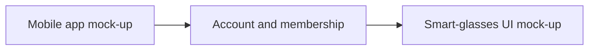
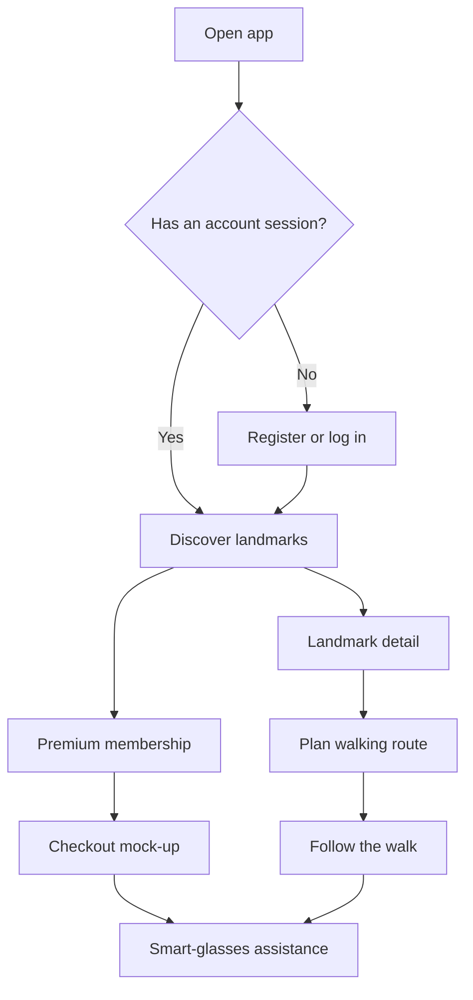

# Architecture

**Status: HYPOTHESIS and coursework planning. Not a validated information architecture.**

This file describes how the mock-up could be structured so the Week 9 prototype can meet the brief. Screen contents, labels, and priority are not user requirements. Those belong in `docs/phase-1/07-user-requirements/` after you write them from evidence.

## Product shape



The diagram is a planning sketch. Membership gating is required by the brief so that premium glasses content is reached through sign-up and checkout. It is not evidence that tourists want a subscription.

## Information architecture hypothesis

Top-level places a tourist might move between. Rename or remove items when your journeys say something more specific.

| Area | Purpose in the hypothesis | Tier |
|---|---|---|
| Discover | Find landmarks and attractions | Free |
| Route | Organise chosen places into a walk | Free |
| Place detail | Decide whether a landmark belongs on the walk | Free |
| Saved | Return to places the person marked | Free, unless research says otherwise |
| Account | Register, log in, profile, sign out | Required by the brief |
| Membership | Premium explanation, order, checkout | Required by the brief |
| Glasses assist | Direction overlay, voice, hands-free controls | Premium hypothesis |
| Help | Short guidance and accessibility preferences | Unprioritised until the accessibility persona exists |

### Flow hypothesis



**ILLUSTRATIVE planning diagram.** Do not submit this figure as a user journey map or as an HTA. Journey maps are persona-specific and must be drawn by you. HTAs decompose tasks with plans and must also be drawn by you.

## Flows to prototype in Week 9

Map these to Figma sections when prototyping starts. Do not build them before the Phase 1 review.

| Flow | What the prototype needs to demonstrate | Origin |
|---|---|---|
| A. Discover | Browse free landmark content and open a place | Feature hypothesis F1 and the brief |
| B. Walking plan | Choose places and arrange a walking route | Feature hypothesis F2 and the brief |
| C. Account | Register and log in, including a path for someone who already has an account | Brief |
| D. Membership | Sign up, confirm the order, checkout | Brief. One journey map must include a premium purchase |
| E. Glasses | Enter premium assistance and show the glasses UI: visual direction, voice, hands-free | Feature hypothesis F3 and the brief |

The brief’s Week 5 checklist asks for three journey maps, with one covering a premium smart-glasses feature. The brief’s method section also says one map must include purchasing a premium membership. Confirm with your lecturer whether one persona’s map may carry both moments. Draft email: `research/lecturer-email-draft.md`.

## Smart-glasses interaction concept

**HYPOTHESIS.** A companion layer for a walk already planned on the phone.

| Channel | Role in the concept | Open question for research |
|---|---|---|
| Display | Short direction overlay: glyph, distance, one instruction | Where the overlay can sit without hiding the street is unknown |
| Speech | Spoken next step; possible spoken commands | Which commands are realistic on a busy street is unknown |
| Hands-free | Advance, repeat, or pause without a precise touch | The fallback when voice fails is undecided |
| Phone | Setup, permissions, membership, and a full route the glasses do not try to duplicate | How much stays on the phone is a design decision after research |

No device brand is selected. Do not describe a commercial glasses product as if it were the platform unless you document that choice from a real specification you have read.

## Figma organisation

Proposed file structure for when prototyping starts. **PROPOSAL — you evaluate.**

| Page | Contents |
|---|---|
| 00 Cover | Title, module, your name, status, link to research limits |
| 01 Flows | User flows A–E as clickable prototypes |
| 02 Components | Buttons, cards, lists, form fields, overlays |
| 03 Mobile screens | High-fidelity phone frames |
| 04 Smart glasses | Separate frames, not phone screens scaled down |
| 05 Accessibility | Text size, contrast, and the adjustments your persona evidence requires |
| 06 Archive | Rejected sketches, kept so you can explain decisions in Week 9 |

Frame sizes to set up and then check on a real phone if you can:

| Frame | Size | Use |
|---|---|---|
| Primary phone | 390 × 844 | Main interactive prototype |
| Compact phone | 360 × 800 | Check wrapping and bottom navigation |
| Glasses | A wide, short frame you define | Overlay only. Record the size you chose and why |

Name frames by flow and state, for example `A-discover / default` and `D-checkout / error`. Avoid final visual styling until you have accepted or replaced the proposals in `DESIGN.md`.

Prototype links the Week 9 demo should be able to follow without you drawing the path by hand:

1. Logged-out visitor registers, or an existing user logs in.
2. From Discover, the person opens a landmark and adds it to a walk.
3. From the walk, the person opens membership, completes checkout, and reaches glasses assistance.

Paper sketches in `docs/phase-2/paper-prototypes/` come before these high-fidelity frames.

## Repository map

```text
docs/phase-1/    Week 5 research writing and evidence templates
docs/phase-2/    Sketches, Figma notes, glasses UI, demo script
docs/phase-3/    Protocol, consent, results, analysis, report
research/        Limits, method plan, source register, reading notes
assets/          Files you export: screenshots, diagrams, sketches
submissions/     The Word and PDF files you actually upload
```

Assessed diagrams live as images you create and place in the Word template. Mermaid in this repository is for planning only.
