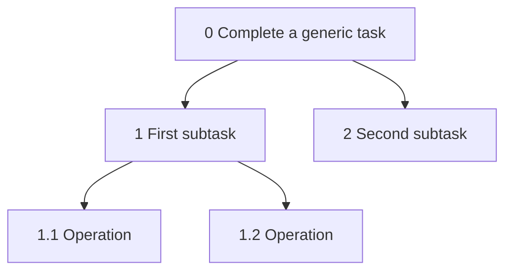

# HTA student worksheet

**Official heading:** Hierarchical Task Analysis (HTA)  
**Template instruction:** Include your three HTA flowcharts here.  
**Status: NOT STARTED.** You name the three goals and draw the three charts. The synthesis does not decompose tasks for you.

The brief asks for Hierarchical Task Analyses for each of the three main features (Theil, 2026).

You draw the three flowcharts. This worksheet is where you draft the hierarchy before you draw. Mermaid is allowed here only as a personal sketch if you wish. **The assessed submission needs your flowcharts as figures.** A planning diagram from `ARCHITECTURE.md` does not count.

## Notation you will use

HTA states a goal, breaks it into tasks and operations, and adds a **plan** that says in what order the subtasks run, including choices and repeats.

Numbering convention:

- `0` goal
- `1`, `2`, `3` tasks under the goal
- `1.1`, `1.2` operations under task 1
- A plan sits with the parent. Example shape: `Plan 0: do 1, then 2, then 3. If [condition], repeat 2.`

**ILLUSTRATIVE numbering only.** The generic figure shows the grammar of a chart. It is not a Smart Travel Companion task, and it must not appear in the checklist as one of your three HTAs.

Plan 0 in that generic figure would be written beside the chart by you, for your real tasks. The figure above has no plan because it has no real task.

## Feature goals

Name each goal from your journeys and MoSCoW list. Until those exist, leave the goal lines blank. Do not paste F1–F3 in as if the analysis were done.

| HTA | Feature goal (your words) | Linked requirements | Linked persona journey |
|---|---|---|---|
| HTA 1 | | | |
| HTA 2 | | | |
| HTA 3 | | | |

The premium smart-glasses feature needs to be one of the three if it remains one of your three main features.

## Draft hierarchy — HTA 1

**Goal 0:**

**Plan 0:**

| ID | Task or operation | Notes from the journey |
|---|---|---|
| 1 | | |
| 1.1 | | |
| 2 | | |
| 3 | | |

**Plans for any task that has subtasks:**

**Diagram file (you create this):** `assets/diagrams/`

## Draft hierarchy — HTA 2

**Goal 0:**

**Plan 0:**

| ID | Task or operation | Notes from the journey |
|---|---|---|
| 1 | | |
| 2 | | |
| 3 | | |

**Plans for any task that has subtasks:**

**Diagram file:**

## Draft hierarchy — HTA 3

**Goal 0:**

**Plan 0:**

| ID | Task or operation | Notes from the journey |
|---|---|---|
| 1 | | |
| 2 | | |
| 3 | | |

**Plans for any task that has subtasks:**

**Diagram file:**

## Drawing check

- [ ] Each chart has a goal, not a screen name only
- [ ] Each parent with children has a plan
- [ ] Plans show sequence, and show a choice where the journey has one
- [ ] The glasses HTA includes the modalities you are actually designing: display, speech, hands-free. Drop a modality if your requirements drop it
- [ ] Operations are small enough to match a paper sketch later
- [ ] The image in the Word file is yours
